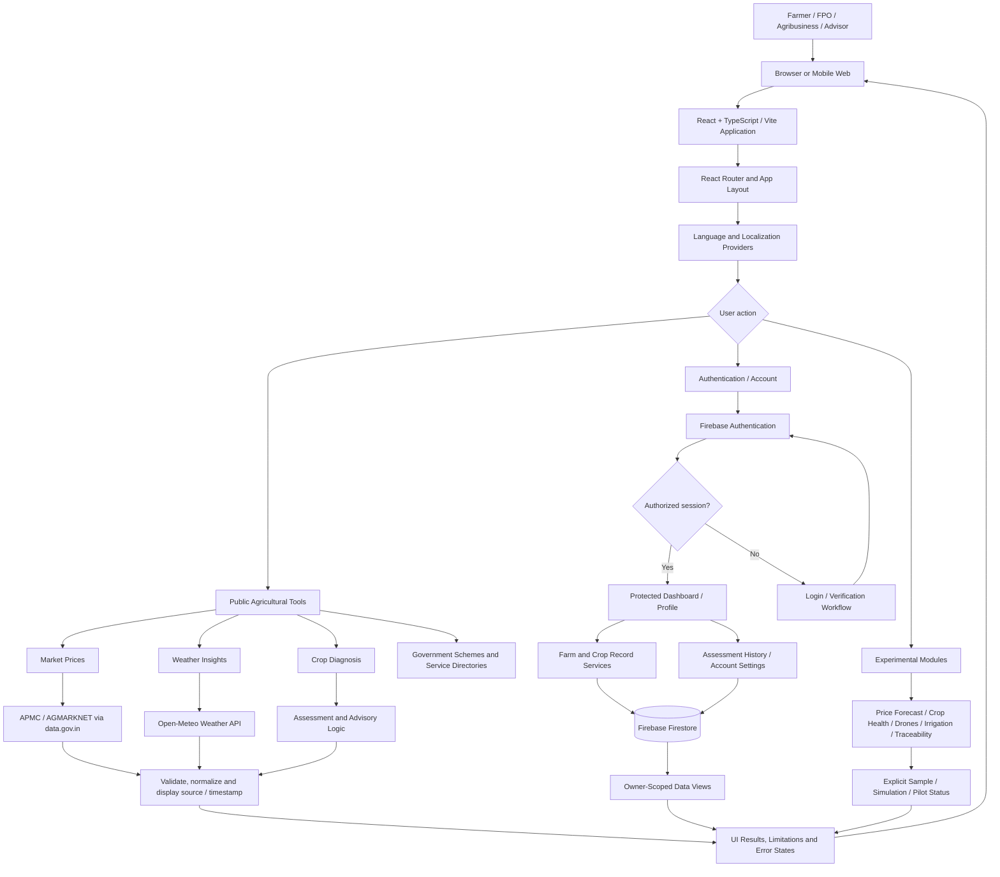
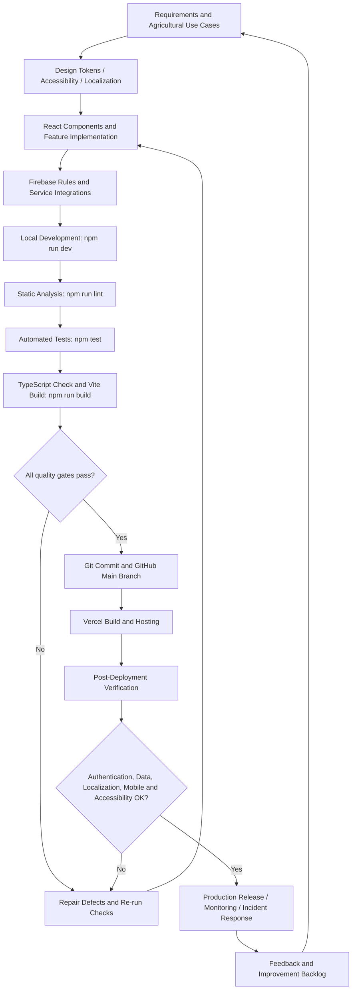

# Farmculture AI — Enterprise Agronomy Intelligence Platform

Farmculture AI is a production-engineered agronomy software platform designed for Indian smallholder farmers, Farmer Producer Organizations (FPOs), agribusinesses, and agricultural extension advisors. It delivers verified APMC mandi arrival intelligence, hyper-local meteorological telemetry, and foliar diagnostic assistance.

---

## 🎨 Enterprise Design System & Tokens

Farmculture AI enforces a restrained, high-contrast agronomic visual palette. **Blue, purple, and indigo accents are strictly prohibited** in presentation layers.

### 1. Color Ramp & CSS Variables
All tokens are defined in `src/index.css` and map directly to Tailwind utilities:

```css
:root {
  /* Brand: Modern Agronomy Lab */
  --color-forest-deep: #0F2E24;     /* Primary brand, headers, high-contrast text */
  --color-forest-mid: #1C4A3A;      /* Primary interactive controls, cards */
  --color-forest-light: #265B47;    /* Secondary hover states */
  --color-forest-subtle: #EDF4F0;   /* Light tint background */

  /* Accent & Highlights */
  --color-lime-leaf: #9BE564;       /* Primary accent, badges, focus highlights */
  --color-lime-soft: #E8F9DC;       /* Muted accent badge background */
  --color-lime-dark: #3F7517;       /* High-contrast accessible text on lime */

  /* Semantic Status Tokens (AA Compliant in Light & Dark Mode) */
  --color-success: #2F9E6B;         /* Nominal / healthy states */
  --color-warning: #E9A23B;         /* Saffron / moderate advisory states */
  --color-danger: #C8553D;          /* Terracotta / high severity alerts */
  --color-info: #3E8E8A;            /* Deep teal / information */

  /* Neutral Stone & Sand Palette */
  --color-paper: #F6F4EE;           /* Warm background */
  --color-surface: #FFFFFF;         /* Card background */
  --color-stone-50: #FAF9F5;        /* Subtle container fill */
  --color-stone-200: #E7E3D8;       /* Hairline borders */
  --color-stone-500: #787266;       /* Accessible secondary text (≥4.5:1) */
  --color-stone-900: #1B1F1C;       /* Primary body text */
}
```

### 2. Typography & Numbers
- **Display Headings:** `Bricolage Grotesque` (`font-display`), tracking `-0.025em`.
- **UI & Multi-Script Body:** `Plus Jakarta Sans` with fallback to `Noto Sans Devanagari` (Hindi/Marathi), `Noto Sans Tamil`, `Noto Sans Telugu`, and `Cairo` (Arabic).
- **Tabular Numerals:** Always use `.tabular-nums` for financial rates, yield figures, and acreage to ensure fixed-width character alignment.

### 3. Spacing, Radii & Elevation
- **Spacing:** Strict 4px base grid (`p-1`, `p-2`, `p-3`, `p-4`, `p-6`, `p-8`).
- **Radii:** Standardized to `8px` (`rounded-lg`), `12px` (`rounded-xl`), and `16px` (`rounded-2xl`).
- **Elevation:** Hairline borders (`border border-[#E7E3D8]`) combined with subtle shadows (`shadow-2xs`, `shadow-xs`, `shadow-sm`).

---

## 🌐 How to Add a New Language (i18n Architecture)

The internationalization layer is typed and supports 10 locales: English (`en-IN`), Hindi (`hi-IN`), Tamil (`ta-IN`), Telugu (`te-IN`), Marathi (`mr-IN`), French (`fr-FR`), Spanish (`es-ES`), German (`de-DE`), Polish (`pl-PL`), and Arabic (`ar-KW` with automatic RTL).

### Step-by-Step Guide:

1. **Register the Locale Type in `src/lib/localeConfig.ts`:**
   ```typescript
   export type SupportedLocale = 'en-IN' | 'hi-IN' | 'ta-IN' | 'bn-IN' | ...;
   export const SUPPORTED_LOCALES: SupportedLocale[] = [...];
   ```

2. **Add the Translation Dictionary in `src/contexts/LanguageContext.tsx`:**
   Add a new language table to `dict`:
   ```typescript
   export const dict: Record<Lang, any> = {
     en: { ... },
     hi: { ... },
     bn: {
       "welcome": "ফার্মকালচারে স্বাগতম",
       "health.title": "ফসল স্বাস্থ্য মনিটর",
       ...
     }
   };
   ```

3. **Intl Formatting Integration:**
   Formatting for dates, relative time, and currency is handled automatically by `src/lib/formatters.ts`:
   - `formatDate(date, locale)`
   - `formatRelativeTime(isoString, locale)`
   - `formatCurrencyINR(amount, locale)`
   - `pluralizeIssues(count, locale)`

4. **Verify Translation Completeness:**
   Run the automated Vitest dictionary suite to verify zero missing keys:
   ```bash
   npx vitest run src/test/localizationCompleteness.test.ts
   ```

---

## 🛡️ Data Provenance & Real Data vs Demonstration

| Data Domain | Provider / Source | Update Cadence | Behavior / Status |
| :--- | :--- | :--- | :--- |
| **Hyperlocal Weather** | Open-Meteo High-Resolution Ensemble Models (DWD ICON / ECMWF) | 15 Minutes | Live API with cached regional fallback |
| **APMC Mandi Rates** | Government of India AGMARKNET & data.gov.in wholesale records | Daily | Real quotes per kg/quintal |
| **Foliar Diagnosis** | Client TensorFlow vision model + KVK advisory rules | Real-Time | Bounded decision support |
| **Crop Health Remote Sensing** | Sentinel-2 multispectral vegetation index simulation | Periodic Sample Pass | Isolated sample data behind a dismissible banner |
| **Market Predictor** | Econometric seasonal heuristic models | On-Demand | Forecast simulation (not yet backtested) |

---

## 🚀 Development & Testing Commands

```bash
# Install dependencies
npm install

# Start local development server (Vite)
npm run dev

# Run Vitest automated test suite (20 suites, 91 tests)
npm test

# Production build & TypeScript check
npm run build
```

---

## 📋 Production Readiness Matrix & Audit History

For comprehensive audit logs, checklist evaluations, and security registers:
- [`docs/audit/reel-checklist-assessment.md`](docs/audit/reel-checklist-assessment.md) — 10-point technical web quality audit.
- [`docs/audit/defect-register.md`](docs/audit/defect-register.md) — Issue registry & verified resolutions.
- [`docs/readiness-matrix.md`](docs/readiness-matrix.md) — Enterprise readiness matrix across all modules.

---

## 🏗️ End-to-End System Architecture

The following diagrams describe the application workflow from user entry to production delivery. External data and demonstration-only modules are separated intentionally.

### 1. Application & Data Flow



**Data trust boundary:** External market and weather data are subject to availability, geographic coverage, provider timestamps, and fallback behavior. Experimental outputs are not equivalent to verified field measurements. Protected records must remain subject to Firebase Authentication and deployed Firestore security rules.

### 2. Development-to-Deployment Lifecycle



### 3. Principal Source Files

| Layer | Main Implementation | Responsibility |
| :--- | :--- | :--- |
| Application shell | `src/App.tsx` | React Router, page composition and access boundaries |
| UI system | `src/index.css`, `src/components/ui/` | Design tokens, reusable primitives and focus styling |
| Navigation | `src/components/navigation/AppSidebar.tsx` | Sidebar, experimental feature grouping and mobile tabs |
| Localization | `src/contexts/LanguageContext.tsx`, `src/lib/localeConfig.ts`, `src/lib/formatters.ts` | Translations, locale/region choices and number/date formatting |
| Authentication | `src/contexts/AuthContext.tsx`, `src/components/ProtectedRoute.tsx` | Session handling and guarded views |
| Agricultural records | `src/lib/farmService.ts`, `firestore.rules` | Farm records and database access controls |
| Weather | `src/lib/weatherService.ts` | Open-Meteo requests and derived agricultural alerts |
| Testing | `src/test/` | Automated component, feature and service checks |
| Delivery | `vite.config.ts`, `vercel.json` | Build configuration and SPA hosting rules |

**Verification note:** This is an implementation-oriented architecture diagram, not proof that every external service or production control is operational. Test counts, provider refresh frequencies, model claims, and accessibility conformance must be verified against the running build before being treated as certification.
