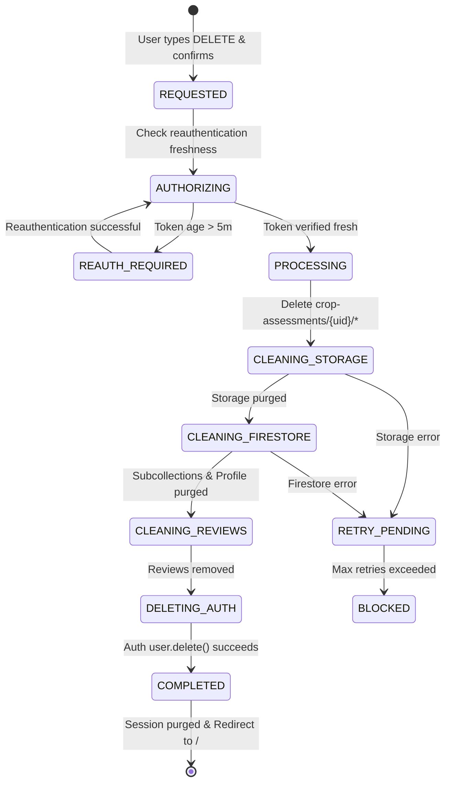

# Account Deletion Architecture and Reliability Engine

## 1. Architectural Philosophy
Account deletion is a mission-critical privacy operation. Simply calling `user.delete()` in Firebase Authentication leaves behind orphaned database records, storage files, and user identifiers.

Farmculture AI implements a **Two-Tier Trusted Deletion Architecture**:
1. **Client Orchestration with Reauthentication Enforcement**:
   - The user must explicitly reauthenticate (password or Google OAuth popup) if their token is older than 5 minutes (`auth/requires-recent-login`).
   - The user must enter the exact typed confirmation phrase (`DELETE`).
2. **Reliable Deletion Engine (`accountDeletionService.ts`)**:
   - Executes ordered, idempotent cleanup across all data stores.
   - Durably tracks step status: `REQUESTED` -> `PROCESSING` -> `COMPLETED` (or `RETRY_PENDING` / `BLOCKED`).
   - Handles recursive subcollection deletion for Firestore (`farms`, `crop_records`, `assessments`).
   - Recursively deletes user-partitioned Storage objects (`crop-assessments/{uid}/**`).
   - Removes or pseudonymizes secondary references (`/reviews`).
   - Only triggers Firebase Auth credential deletion once downstream storage and database records have been verified deleted.
   - Clears local client caches and storage.

---

## 2. Deletion Job State Machine

---

## 3. Idempotency & Partial Failure Recovery
- **Idempotency**: Every cleanup function (`deleteUserFarms`, `deleteUserAssessments`, `deleteUserStorageFiles`) is inherently idempotent. Running it multiple times on an already deleted set yields zero errors and succeeds cleanly.
- **Error Handling**: If a transient network glitch occurs during Storage cleanup, the engine does not falsely report that the account was deleted. It surfaces a clear error and allows the user to re-trigger cleanup safely without duplicating state.
