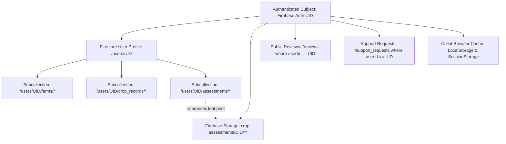

# User Data Inventory and Deletion Dependency Graph

## 1. Executive Summary
This document provides a comprehensive inventory of all personal, agricultural, operational, and diagnostic records tied to an authenticated user (`uid`) across the Farmculture AI platform. In compliance with privacy engineering standards (GDPR Art. 17, Indian DPDP Act 2023, ISO/IEC 27701), permanent account deletion requires complete removal or lawful pseudonymization of all linked resources without leaving orphaned records.

---

## 2. Inventory of User-Linked Resources

| Resource Store | Path / Entity | Identity Binding | Data Categories | Deletion Strategy |
|:---|:---|:---|:---|:---|
| **Firebase Auth** | `auth.users(uid)` | Primary Subject (`uid`) | Email, display name, password hash, provider data, creation timestamp, last sign-in. | Server/Client Firebase Auth account deletion after data cleanup. |
| **Firestore** | `/users/{uid}` | Document ID = `uid` | User profile, display name, preferred locale, default region, display currency preference, account created timestamp. | Delete document during deletion orchestration. |
| **Firestore Subcollection** | `/users/{uid}/farms/{farmId}` | Parent path includes `uid` | Farm plot names, GPS/district locations, state, cultivated acreage, soil classification, irrigation type, primary crops. | Recursive query & batch delete all documents under subcollection. |
| **Firestore Subcollection** | `/users/{uid}/crop_records/{cropId}` | Parent path includes `uid` | Sowing dates, crop variety, planted acreage, growth stages, estimated harvest dates, field logs. | Recursive query & batch delete all documents under subcollection. |
| **Firestore Subcollection** | `/users/{uid}/assessments/{assessmentId}` | Parent path includes `uid` | Foliar diagnosis records, detected disease condition, severity level, leaf chromatic metrics, confidence score, treatment recommendations, image reference URLs. | Recursive query & batch delete all documents under subcollection. |
| **Firebase Storage** | `crop-assessments/{uid}/**` | Folder path = `uid` | Photographic leaf specimens uploaded for AI computer vision diagnosis (`{assessmentId}.jpg`). | List all storage items under prefix `crop-assessments/{uid}/` and delete each file. |
| **Firestore** | `/reviews/{reviewId}` | Field `userId == uid` | Star ratings (1–5), reviewer text, reviewer name/handle, moderation status, creation timestamp. | Query `/reviews` where `userId == uid`. Delete reviews or remove author identifiers while recalculating aggregate community rating. |
| **Firestore** | `/support_requests/{requestId}` | Field `userId == uid` | Inquiries submitted via Contact Us form, email address, message payload, status, submission date. | Subject to legal retention exceptions (dispute resolution / fraud prevention). De-identify or securely delete. |
| **Client Storage** | `localStorage`, `sessionStorage` | Client Browser Cache | Preferences (`farmculture_user_preferences_v1`), foreign exchange cache (`farmculture_fx_cache_v2`), auth state cache. | Client-side cache purge upon completion of deletion workflow. |

---

## 3. Resource Dependency Graph

---

## 4. Deletion Sequence & Ordering Requirements

1. **Phase 1: Lockout & Deletion Job Registration**:
   - Establish deletion intent. Record durable deletion job status: `REQUESTED` -> `PROCESSING`.
   - Prevent new concurrent writes to farm/crop/assessment records.
2. **Phase 2: Storage Data Cleanup**:
   - Delete all files located in Firebase Storage at `crop-assessments/{uid}/**`.
   - Ensure storage deletion is validated before proceeding.
3. **Phase 3: Database Child & Subcollection Cleanup**:
   - Delete all documents in `/users/{uid}/assessments`.
   - Delete all documents in `/users/{uid}/crop_records`.
   - Delete all documents in `/users/{uid}/farms`.
4. **Phase 4: Shared & Denormalized Entities Cleanup**:
   - Query `/reviews` where `userId == uid` and delete documents (or de-identify author identifiers).
   - Recalculate/invalidate aggregate ratings if applicable.
   - De-identify personal contact details in `/support_requests`.
5. **Phase 5: Primary User Document Deletion**:
   - Delete `/users/{uid}` profile document.
6. **Phase 6: Authentication Identity Revocation & Deletion**:
   - Delete Firebase Authentication user record (`user.delete()`).
   - Terminate active session and purge client tokens.
7. **Phase 7: Client State Invalidation & Redirection**:
   - Clear `localStorage` and `sessionStorage`.
   - Redirect to public homepage with truthful confirmation.
