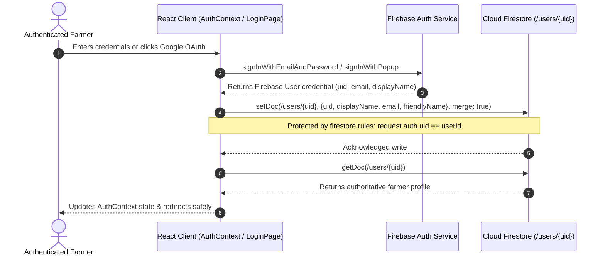
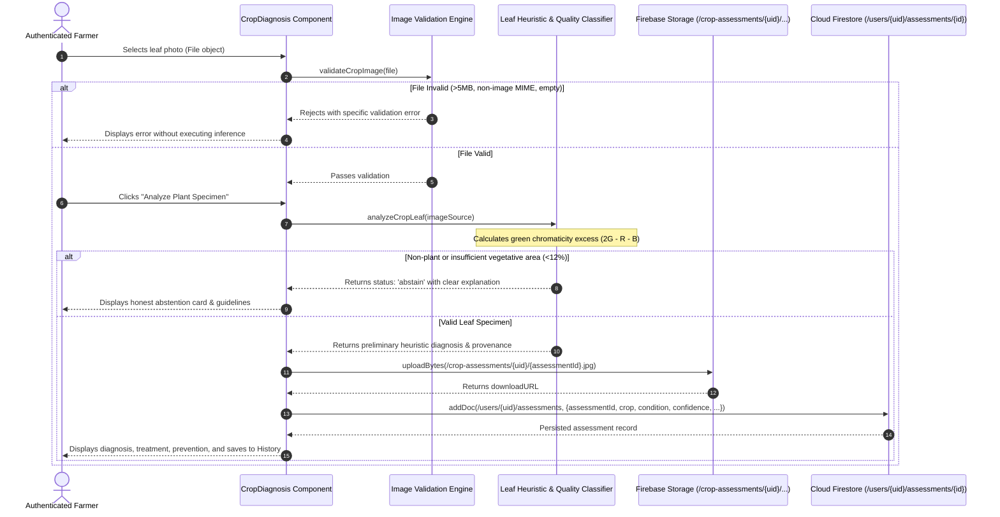
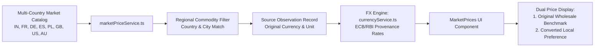

# Data Flow & Security Model — Farmculture AI

**Date:** 2026-10-22  
**Auditor:** Principal Full-Stack Architect, Security Engineer  
**Status:** Baseline Audited  

---

## 1. Authentication & Profile Retrieval Data Flow



### Security Invariants (FC-08)
- No user profile can be retrieved or written using arbitrary query parameters or unverified client strings.
- Profile path is strictly `/users/{userId}` where `request.auth.uid == userId`.
- Cross-user reads and writes are rejected with `PERMISSION_DENIED`.

---

## 2. Core Farmer Crop Diagnosis & Assessment Flow



---

## 3. Market Commodity Pricing & FX Data Flow



### Truthfulness Invariant
- Indian APMC mandi prices are never renamed or converted to masquerade as European wholesale markets.
- All benchmark prices disclose country, market name, commodity, observation date, and original unit.

---

## 4. Community Reviews Flow & Moderation

```mermaid
sequenceDiagram
  autonumber
  actor Farmer as Authenticated Member
  participant UI as Review Form / ReviewCarousel
  participant Service as reviewService.ts
  participant Firestore as Cloud Firestore (/reviews/{reviewId})

  Farmer->>UI: Submits rating (1-5) and reviewText (>=5 chars)
  UI->>Service: submitUserReview(userId, displayName, submission)
  Note over Service: Validates userId == auth.uid & input bounds
  Service->>Firestore: addDoc(/reviews, {userId, displayName, rating, reviewText, ...})
  Firestore-->>Service: docRef.id
  Service-->>UI: Success
  UI->>Service: getApprovedReviews()
  Service->>Firestore: query(reviews, where moderationStatus == 'approved')
  Firestore-->>Service: Actual approved records
  Service->>Service: computeReviewStats(reviews)
  Note over Service: Calculates genuine mathematical average; no hardcoded 4.9
  Service-->>UI: Renders verified community feedback carousel
```
