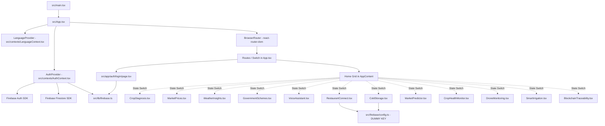

# Dependency Map & Architecture Trace — Farmculture AI

**Date:** 2026-10-21  
**Repository:** Farmculture AI  

---

## 1. System Dependency Graph

---

## 2. Component Data Flow & Failure Paths

### A. Crop Diagnosis
- **Entry:** Click "Crop Diagnosis" card -> sets `activeFeature = "diagnosis"`.
- **Flow:** User selects image -> `FileReader` generates base64 data URL -> User clicks "Analyze Crop" -> `analyzeCrop()` starts.
- **Root Failure:** No image analysis or backend API call exists. Replaced with `setTimeout(3000)` and static mock payload with 87% confidence. Non-plant images receive same valid disease diagnosis.
- **Intended Flow:** Input validation (file size < 5MB, format jpeg/png/webp, aspect ratio, leaf visual confirmation heuristics) -> Model inference / API endpoint with abstention support -> Honest classification with error boundary, confidence thresholding (>75% for diagnosis, otherwise abstention / unverified guidance).

### B. Market Prices
- **Entry:** Click "Market Prices" card -> sets `activeFeature = "markets"`.
- **Flow:** Mounts -> `useEffect` triggers `fetchPrices()` -> `setTimeout(800)` -> populates `mockPrices` dated `2025-01-19`.
- **Root Failure:** No live market API integration. Synthetic percentage changes (+50%, -20%) presented as current facts.
- **Intended Flow:** Query live/cached market data feed (e.g. Open Government Data Platform / Agmarknet API or verified provider) -> Schema validation -> Provenance metadata (market, commodity, arrival date, price/quintal normalized to kg, source) -> Graceful degradation with clear stale/offline banner if provider is unavailable.

### C. Weather Insights
- **Entry:** Click "Weather Insights" card -> sets `activeFeature = "weather"`.
- **Flow:** Mounts -> `useEffect` triggers `fetchWeatherData()` -> `setTimeout(2000)` -> populates fixed 28°C static object.
- **Root Failure:** No real location query or meteorological API. Synthetic AI alerts without real weather triggers.
- **Intended Flow:** Browser Geolocation API (with default location fallback, e.g. New Delhi / Maharashtra) -> Open-Meteo Weather Forecast API (free, open, no secret keys) -> Map real temperature, humidity, precipitation probability, wind speed, UV index -> Compute agronomical advisory rules from real data.

### D. Firebase Authentication & Firestore (FC-08)
- **Entry:** `src/app/auth/login/page.tsx` & `src/contexts/AuthContext.tsx`.
- **Flow:**
  1. Login page: `createUserWithEmailAndPassword` or `signInWithEmailAndPassword` or Google Popup.
  2. Write to Firestore: `setDoc(doc(db, "users", uid), { uid, displayName, email, friendlyName })`.
  3. `AuthContext.tsx`: `onAuthStateChanged` receives user. Then attempts:
     - `getDoc(doc(db, "users", u.uid))`
     - If not found, falls back to `getDoc(doc(db, "users", friendly))` where `friendly` is unverified string.
- **Root Failure:** Friendly name lookup creates potential for document collisions and identity confusion. No `firestore.rules` exist in the repository to guarantee that `request.auth.uid == resource.id`.
- **Intended Flow:** Authoritative user records stored strictly under `users/{uid}`. Client cannot query arbitrary friendly-name documents. Security rules enforce that `request.auth != null && request.auth.uid == userId`.

---

## 3. Package & Module Dependency Analysis

| Module | Source | Dependent Consumers | Risk / Issue |
|---|---|---|---|
| `firebase` (v10.14.1) | npm | `src/lib/firebase.ts`, `src/firebase/config.ts`, `AuthContext.tsx`, `Header.tsx`, `login/page.tsx`, `RestaurantConnect.tsx`, `ColdStorage.tsx` | Two competing config files (`src/firebase/config.ts` vs `src/lib/firebase.ts`). Need to eliminate duplicate dummy config. |
| `react-router-dom` (v7.9.1) | npm | `src/App.tsx`, `src/components/Header.tsx`, `src/app/auth/login/page.tsx` | App.tsx has router instantiated but renders nested features via conditional state instead of genuine route paths. |
| `vitest` (v2.1.9) | npm (dev) | None currently | Installed in `package.json`, but no test config or test files exist. |
| `globals` | npm (dev) | `eslint.config.js` | Missing from `package.json`, causing `eslint` to crash immediately. |
| `framer-motion` (v12.23.12) | npm | `WeatherInsights.tsx`, `IntelligencePanel.tsx`, `CropHealthMonitor.tsx`, etc. | Working, but unused import `import { footer } from "framer-motion/client"` in `translations.ts` causes dead weight. |
